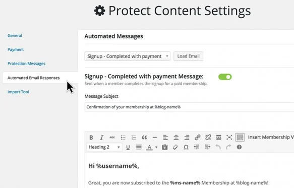
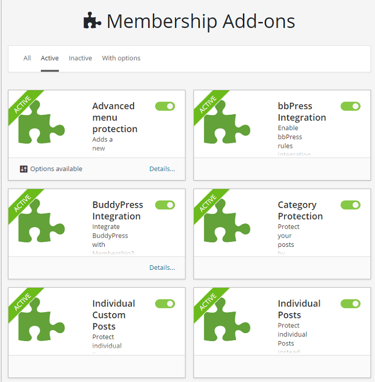

# Automatisierte E-Mails und Erweiterungen

[← Zur Übersicht](./index.md)

## Automatisierte E-Mails

Unter **Mitgliedschaften → Einstellungen → Automatisierte E-Mail-Antworten** werden globale E-Mail-Ereignisse verwaltet. Auf Mitgliedschaftsebene können Texte und Verhalten bei Bedarf abweichen.

Typische Ereignisse:

- Konto erstellt und E-Mail-Bestätigung,
- Anmeldung und kostenlose Registrierung,
- Zahlung bzw. Rechnung,
- Zahlung fällig oder fehlgeschlagen,
- Testzeitraum endet,
- Mitgliedschaft wird verlängert, beendet oder gekündigt,
- Passwort zurücksetzen und Profildaten ändern.

### Gute E-Mail-Konfiguration

1. Aktiviere nur Ereignisse, die Du tatsächlich betreuen kannst.
2. Verwende Platzhalter aus dem Editor, statt Rechnungsnummern oder URLs fest einzutragen.
3. Setze eine eindeutige Absenderadresse.
4. Teste HTML- und Textdarstellung in mehreren Mailprogrammen.
5. Prüfe die E-Mail-Protokolle nach einem Testlauf.

Bei System-Cron werden Nachrichten über eine Warteschlange versendet. Ohne System-Cron kann der Versand direkt beim Ereignis erfolgen.

## Add-ons gezielt aktivieren

Unter **Mitgliedschaften → Erweiterungen** aktivierst Du Funktionen nur bei Bedarf.

| Add-on | Zweck |
|---|---|
| Gutscheine | Rabatte oder kostenfreie Zugänge über Codes. |
| Einladungen | Registrierung nur mit Einladungscode. |
| Profilfelder | Zusätzliche Daten beim Mitglied erfassen. |
| Attribute | Eigene Mitgliedschaftsattribute für Darstellung und Regeln. |
| Anteilsberechnung | Bereits gezahlte Beträge bei Wechseln berücksichtigen. |
| Rechnungen | Erweiterte Rechnungsausgaben. |
| Kategorien / Medien | Kategorie- bzw. Dateischutz. |
| Mailchimp | Mitgliederlisten mit Mailchimp abgleichen. |
| bbPress / BuddyPress / PS Forum | Bereiche der jeweiligen Community-Integration schützen. |
| reCaptcha | Schutz für Anmeldung und Registrierung. |
| Weiterleitungen | Zielseiten nach Login oder Logout steuern. |
| WPML | Mehrsprachige Mitgliedschaftsseiten. |
| REST API | Schutz- und Mitgliedschaftsfunktionen für API-Szenarien. |

Aktiviere ein Add-on, konfiguriere es, teste es und dokumentiere die Auswirkung. Viele Regeltypen erscheinen erst nach der Aktivierung des zugehörigen Add-ons.

## Integrationen

Externe Dienste wie Stripe, PayPal, Mailchimp oder Taxamo benötigen eigene Zugangsdaten und unterliegen deren Bedingungen. Hinterlege Zugangsdaten nie in öffentlichen Seiten, Screenshots oder Wiki-Beispielen.

