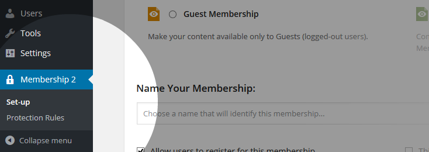

# Schnellstart und Grundkonfiguration

[← Zur Übersicht](./index.md)

## Voraussetzungen

- ClassicPress oder WordPress mit PHP 8.0 oder neuer.
- HTTPS für Anmelde- und Zahlungsseiten.
- Ein Testkonto für die Abnahme der Mitgliederwege.
- Bei externen Zahlungsanbietern: eigene API-Zugangsdaten und, falls erforderlich, Webhooks.

## Installation

1. Lade das Plugin nach `wp-content/plugins/ps-mitgliedschaften/` hoch.
2. Aktiviere **PS Mitgliedschaften** unter **Plugins**.
3. Öffne den Einrichtungsassistenten bzw. **Mitgliedschaften → Einstellungen**.
4. Prüfe die vom Plugin erzeugten oder zugewiesenen Seiten für Registrierung, Anmeldung, Konto und Mitgliedschaftsauswahl.

## Einstellungen verstehen

Unter **Mitgliedschaften → Einstellungen** stehen diese Bereiche zur Verfügung:

| Bereich | Zweck |
|---|---|
| **Allgemeines** | Grundverhalten, Konto- und Registrierungsablauf, Caching und Cron. |
| **Zahlung** | Währung, Rechnungssender und Zahlungs-Gateways. |
| **Schutzmeldungen** | Texte für verweigerten Zugriff und geschützte Inhalte. |
| **Automatisierte E-Mail-Antworten** | Globale E-Mail-Ereignisse und Versandverhalten. |
| **Medien** | Schutz von Dateien und Medien, wenn das Medien-Add-on aktiv ist. |
| **Import Werkzeug** | Übernahme von Mitgliedern und Einstellungen. |

### Wichtige allgemeine Optionen

- **Inhaltsschutz:** Schaltet die Schutzlogik für die Website ein oder aus.
- **Admin-Symbolleiste ausblenden:** Blendet sie für normale Mitglieder aus.
- **System-Cron:** Versendet Warteschlangen-E-Mails im Hintergrund; für stark besuchte Seiten sinnvoll.
- **Zwischenspeicher:** Beschleunigt Abfragen, kann Änderungen aber verzögert sichtbar machen.
- **Standard-Gateway erzwingen:** Beschränkt manuelle Registrierungen auf das vorgegebene Gateway.
- **Kontoüberprüfung:** Verlangt vor dem Zugang eine bestätigte E-Mail-Adresse.

## Systemseiten prüfen

Das Plugin benötigt Seiten für die Registrierung, die Mitgliedschaftsauswahl und die Kontoansicht. Verwende die vom Assistenten angelegten Seiten oder ordne vorhandene Seiten zu.

Prüfe auf jeder Seite:

- Ist der erwartete Shortcode vorhanden?
- Ist die Seite öffentlich erreichbar, sofern sie für Gäste gedacht ist?
- Wird sie nicht zusätzlich durch eine widersprüchliche Schutzregel blockiert?
- Ist sie im Navigationsmenü nur dort sichtbar, wo es sinnvoll ist?

## Abnahmetest nach der Einrichtung

1. Öffne die Seite in einem privaten Browserfenster.
2. Registriere einen Testbenutzer.
3. Wähle eine kostenlose Test-Mitgliedschaft.
4. Melde Dich erneut an und rufe die Kontoansicht auf.
5. Prüfe, ob geschützte und ungeschützte Inhalte erwartungsgemäß erscheinen.

Danach kann die erste kostenpflichtige Mitgliedschaft eingerichtet werden.

