# PS Mitgliedschaften – Handbuch

Dieses Handbuch beschreibt die Einrichtung und den Betrieb von PS Mitgliedschaften für ClassicPress und WordPress. Es richtet sich an Administratoren, Netzwerkadministratoren, Redakteure und Mitglieder und kann direkt in ein Wiki übernommen werden.

## Inhaltsverzeichnis

1. [Schnellstart](#schnellstart)
2. [Single Site und Multisite](#single-site-und-multisite)
3. [Einstellungen](#einstellungen)
4. [Mitgliedschaften anlegen](#mitgliedschaften-anlegen)
5. [Zahlungen und Abrechnung](#zahlungen-und-abrechnung)
6. [Inhalte schützen](#inhalte-schützen)
7. [Mitglieder und Abonnements verwalten](#mitglieder-und-abonnements-verwalten)
8. [Automatisierte E-Mails](#automatisierte-e-mails)
9. [Erweiterungen und Integrationen](#erweiterungen-und-integrationen)
10. [Nutzerleitfaden für Mitglieder](#nutzerleitfaden-für-mitglieder)
11. [Checkliste für den Live-Betrieb](#checkliste-für-den-live-betrieb)

---

## Schnellstart

### Voraussetzungen

- ClassicPress oder WordPress mit PHP 8.0 oder neuer.
- HTTPS für Anmelde- und Zahlungsseiten.
- Ein Testkonto für die Abnahme der Mitgliederwege.
- Bei externen Zahlungsanbietern: eigene API-Zugangsdaten und, falls erforderlich, Webhooks.

### Installation und Einrichtung

1. Lade das Plugin nach `wp-content/plugins/ps-mitgliedschaften/` hoch.
2. Aktiviere **PS Mitgliedschaften** unter **Plugins**.
3. Öffne den Einrichtungsassistenten bzw. **Mitgliedschaften → Einstellungen**.
4. Prüfe die vom Plugin erzeugten oder zugewiesenen Seiten für Registrierung, Anmeldung, Konto und Mitgliedschaftsauswahl.
5. Lege eine Test-Mitgliedschaft an und teste sie vor dem Live-Betrieb.

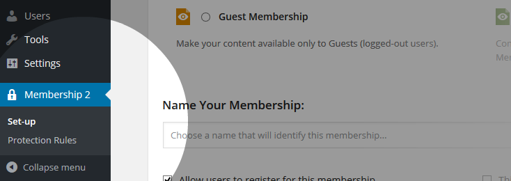

### Systemseiten prüfen

Das Plugin benötigt Seiten für Registrierung, Mitgliedschaftsauswahl und Konto. Verwende die vom Assistenten angelegten Seiten oder ordne vorhandene Seiten zu.

Prüfe auf jeder Seite:

- Ist der erwartete Shortcode vorhanden?
- Ist die Seite öffentlich erreichbar, sofern sie für Gäste gedacht ist?
- Wird sie nicht zusätzlich durch eine widersprüchliche Schutzregel blockiert?
- Ist sie im Navigationsmenü nur dort sichtbar, wo es sinnvoll ist?

---

## Single Site und Multisite

### Single-Site-Betrieb

Im Single-Site-Betrieb gelten Einstellungen, Mitgliedschaften, Schutzregeln und Systemseiten für genau diese Website.

Empfohlener Ablauf:

1. Systemseiten einrichten.
2. Mitgliedschaften und Schutzregeln anlegen.
3. Gast, angemeldeten Benutzer ohne Mitgliedschaft und Mitglied testen.
4. Erst danach weitere Gateways und Add-ons aktivieren.

### Multisite-Betrieb

In einer Multisite-Installation kann PS Mitgliedschaften netzwerkweit betrieben werden. Die netzwerkweite Schutzfunktion ermöglicht zentrale Verwaltung, berücksichtigt jedoch weiterhin die jeweilige Website bzw. Blog-ID in Regeln und Daten.

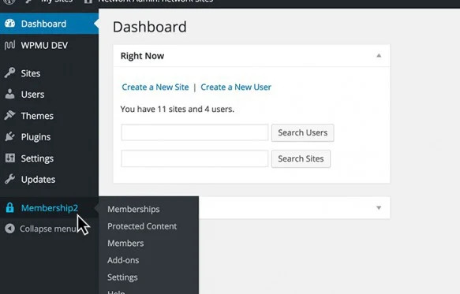

Vor der Aktivierung im Netzwerk:

- Entscheide, ob Mitgliedschaften zentral oder je Website verwaltet werden sollen.
- Prüfe, ob das Plugin netzwerkweit oder nur auf einzelnen Websites aktiviert wird.
- Vermeide parallele bzw. widersprüchliche Aktivierungen.
- Definiere, welche Administratoren Regeln und Zahlungen verwalten dürfen.
- Prüfe alle betroffenen Websites auf eigene Caches, Menüs und Systemseiten.

| Thema | Empfehlung |
|---|---|
| Schutzregeln | Regel immer auf der betroffenen Website testen. |
| Systemseiten | Für jede Website Registrierung, Konto- und Auswahlseiten prüfen. |
| Zahlungen | Eindeutige Rechnungs- und Verwendungszwecke verwenden. |
| Benutzer | Prüfen, wie Benutzerkonten und Rollen netzwerkweit geteilt werden. |
| Caching | Website- und CDN-Caches für geschützte Inhalte getrennt prüfen. |
| Änderungen | Nach Wechsel der netzwerkweiten Schutzart vollständige Tests ausführen. |

### Multisite-Abnahmetest

1. Erstelle oder wähle zwei Websites im Netzwerk.
2. Schütze auf beiden jeweils einen Inhalt.
3. Teste Zugang mit derselben Mitgliedschaft und unterschiedlichen Benutzerkonten.
4. Prüfe Menü, direkte URL, Medien und Kontoansicht je Website.
5. Wiederhole den Test nach Cache-Leerung.

---

## Einstellungen

Unter **Mitgliedschaften → Einstellungen** stehen diese Bereiche zur Verfügung:

| Bereich | Zweck |
|---|---|
| **Allgemeines** | Grundverhalten, Konto- und Registrierungsablauf, Caching und Cron. |
| **Zahlung** | Währung, Rechnungssender und Zahlungs-Gateways. |
| **Schutzmeldungen** | Texte für verweigerten Zugriff und geschützte Inhalte. |
| **Automatisierte E-Mail-Antworten** | Globale E-Mail-Ereignisse und Versandverhalten. |
| **Medien** | Schutz von Dateien und Medien, wenn das Medien-Add-on aktiv ist. |
| **Import Werkzeug** | Übernahme von Mitgliedern und Einstellungen. |

### Wichtige allgemeine Optionen

- **Inhaltsschutz:** Schaltet die Schutzlogik für die Website ein oder aus.
- **Admin-Symbolleiste ausblenden:** Blendet sie für normale Mitglieder aus.
- **System-Cron:** Versendet Warteschlangen-E-Mails im Hintergrund; für stark besuchte Seiten sinnvoll.
- **Zwischenspeicher:** Beschleunigt Abfragen, kann Änderungen aber verzögert sichtbar machen.
- **Standard-Gateway erzwingen:** Beschränkt manuelle Registrierungen auf das vorgegebene Gateway.
- **Kontoüberprüfung:** Verlangt vor dem Zugang eine bestätigte E-Mail-Adresse.

---

## Mitgliedschaften anlegen

Öffne **Mitgliedschaften → Mitgliedschaften → Neu hinzufügen**. Vergib einen eindeutigen Namen, eine verständliche Beschreibung und lege danach Typ, Zugang und Zahlung fest.

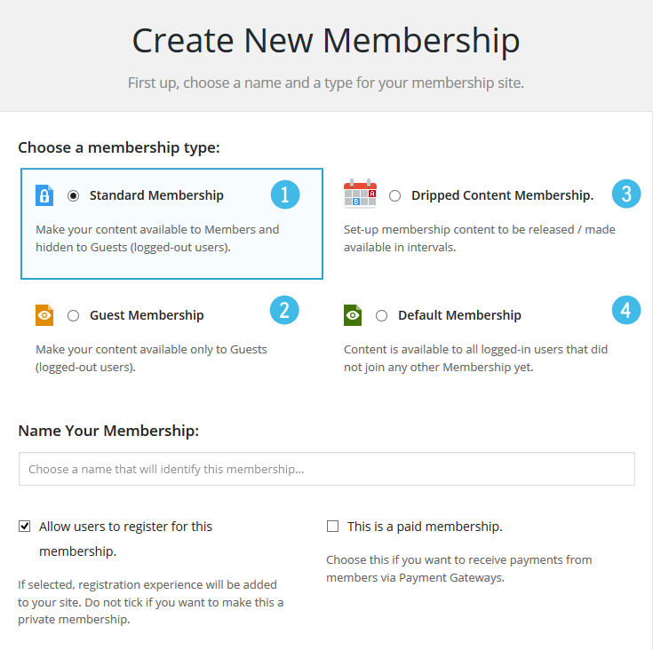

### Mitgliedschaftstypen

| Typ | Geeignet für |
|---|---|
| **Standardmitgliedschaft** | Dauerhafte oder befristete Zugänge zu geschützten Inhalten. |
| **Intervall-Mitgliedschaft** | Zeitversetzte Freischaltung, etwa Lektionen oder Kursmodule. |
| **Gastmitgliedschaft** | Inhalte ausschließlich für nicht angemeldete Besucher. |
| **Keine-Mitgliedschaft** | Inhalte für angemeldete Benutzer ohne sonstige Mitgliedschaft. |

Je nach Typ heißt der Zahlungsbereich **Zahlungsoptionen** oder **Zugriffsoptionen**. Bei Gast- und Keine-Mitgliedschaft sind nicht alle Zahlungsoptionen sinnvoll oder verfügbar.

### Zahlungs- und Zugriffsoptionen

Lege pro Mitgliedschaft fest:

- kostenlos oder kostenpflichtig,
- Preis und Währung,
- einmalige oder wiederkehrende Zahlung,
- Laufzeit und Ablaufverhalten,
- optionalen Testzeitraum,
- zulässige Upgrades und Downgrades,
- passende Systemseiten, Schutzmeldungen und E-Mails.

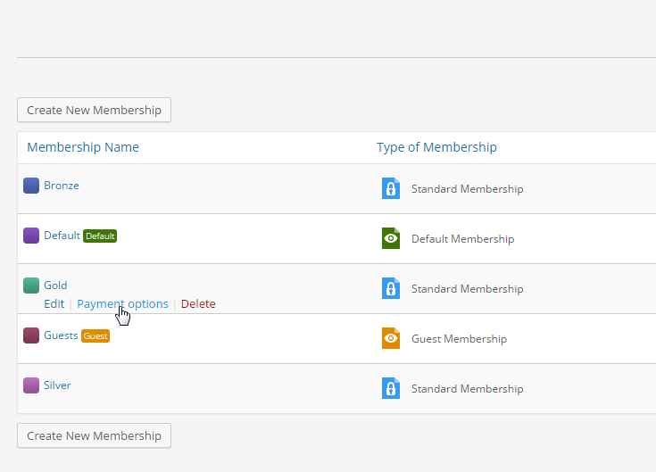

### Upgrades und Downgrades

Lege erlaubte Wechsel nur dann an, wenn Preis, Restlaufzeit und Zielzugang fachlich klar definiert sind. Mit dem Add-on **Anteilsberechnung** können bereits gezahlte Beträge beim Wechsel berücksichtigt werden.

Prüfe Wechsel immer mit Testkonten: Zugang zum alten Inhalt, Zugang zum neuen Inhalt, Rechnung und Folgetermin.

---

## Zahlungen und Abrechnung

### Zahlungs-Gateways

Die globale Gateway-Konfiguration befindet sich unter **Mitgliedschaften → Einstellungen → Zahlung**.

| Gateway | Typischer Einsatz | Hinweis |
|---|---|---|
| **Kostenlos** | Kostenlose Mitgliedschaften | Kein externer Zahlungsdienst nötig. |
| **Manuelle Zahlung** | Überweisung, Barzahlung oder individuelle Rechnung | Zahlung muss durch einen Administrator bestätigt werden. |
| **Stripe** | Karten- und weitere Stripe-Zahlmethoden | Zugangsdaten und Webhooks prüfen. |
| **PayPal Standard / Single** | PayPal-Zahlungen | Sandbox zunächst für Tests verwenden. |
| **Authorize.net** | Authorize.net-Integration | API-Zugangsdaten erforderlich. |

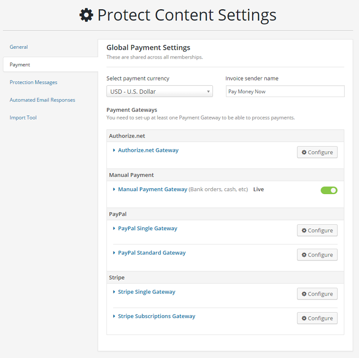

### Externe Zahlungen testen

1. Verwende Testmodus bzw. Sandbox des externen Gateways.
2. Lege eine Test-Mitgliedschaft mit geringem Betrag an.
3. Führe Kauf, Rückkehr zur Website und Kontoansicht durch.
4. Prüfe Rechnung, Transaktionsprotokoll und Mitgliedsstatus.
5. Teste fehlgeschlagene, abgebrochene und wiederkehrende Zahlungen separat.

### Manuelle SEPA-Überweisung

Bei manuellen Zahlungen wird die Rechnung zunächst als **ausstehend** gespeichert. Das Mitglied erhält Überweisungsdaten und bei gültigen Euro-Zahlungen einen EPC-QR-Code.

1. Öffne **Mitgliedschaften → Einstellungen → Zahlung**.
2. Klappe **Manuelles Zahlungsgateway** auf.
3. Trage Kontoinhaber, IBAN sowie optional BIC, Bankname und Verwendungszweck-Präfix ein.

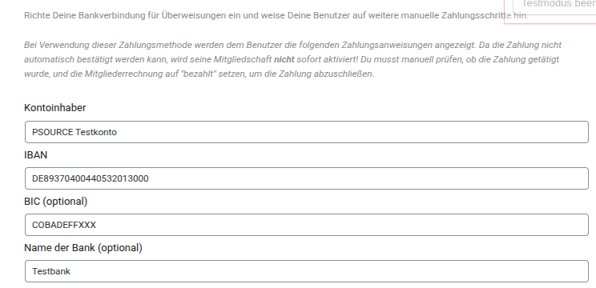

| Feld | Erforderlich | Zweck |
|---|---:|---|
| **Kontoinhaber** | Ja für den QR-Code | Name des Zahlungsempfängers. |
| **IBAN** | Ja für den QR-Code | Zielkonto. Leerzeichen werden beim Speichern entfernt. |
| **BIC** | Nein | Wird verwendet, sofern sie formal gültig ist. |
| **Name der Bank** | Nein | Zusätzliche Information für Mitglieder. |
| **Verwendungszweck-Präfix** | Empfohlen | Wird vor die eindeutige Rechnungsnummer gesetzt. |
| **Zahlungsinformationen** | Nein | Zusätzliche Hinweise, etwa Bearbeitungszeit oder Kontaktadresse. |

Ein QR-Code wird nur erzeugt, wenn die Währung EUR, ein Kontoinhaber, eine gültige IBAN, Betrag und Verwendungszweck vorhanden sind. Die Daten werden lokal verarbeitet und nicht an externe QR-Dienste übertragen.

Sobald ein Mitglied die manuelle Zahlung auswählt, erhält es eine HTML-E-Mail mit Bankdaten, Betrag, Verwendungszweck und eingebettetem QR-Code.

### Rechnung und Zahlungseingang prüfen

Unter **Mitgliedschaften → Abrechnung** findest Du Rechnungen, Transaktionen und Protokolle.

1. Suche die Rechnung anhand der Rechnungsnummer oder des Verwendungszwecks.
2. Vergleiche Betrag und Zahlungseingang.
3. Markiere die Rechnung erst nach vollständigem Zahlungseingang als bezahlt.
4. Prüfe anschließend Mitgliedsstatus und Zugang.

| Status | Bedeutung |
|---|---|
| **Neu** | Rechnung bzw. Anmeldung wurde angelegt, aber noch nicht abgeschlossen. |
| **Ausstehend / billed** | Zahlung wurde angefordert oder manuell ausgewählt, aber noch nicht bestätigt. |
| **Aktiv** | Mitgliedschaft ist gültig und gewährt Zugang. |
| **Testphase** | Zugang ist bis zum Ende des Testzeitraums aktiv. |
| **Abgelaufen / beendet** | Laufzeit ist beendet; Zugang richtet sich nach der Konfiguration. |
| **Gekündigt** | Keine weitere Verlängerung; vorhandener Zugang kann bis zum Ablauf bestehen bleiben. |

Bei wiederkehrenden Zahlungen sind zusätzlich Fälligkeit, fehlgeschlagene Zahlung, Erneuerung, Kündigung und Kartenablauf relevant. Richte hierfür E-Mail-Ereignisse ein und teste mindestens eine erfolgreiche sowie eine fehlgeschlagene Verlängerung im Sandbox-Modus.

---

## Inhalte schützen

Eine Mitgliedschaft allein schützt noch keinen Inhalt. Erst eine Schutzregel legt fest, welche Mitgliedschaft auf welchen Inhalt zugreifen darf.

Öffne **Mitgliedschaften → Schutzregeln** und wähle den passenden Regeltyp.

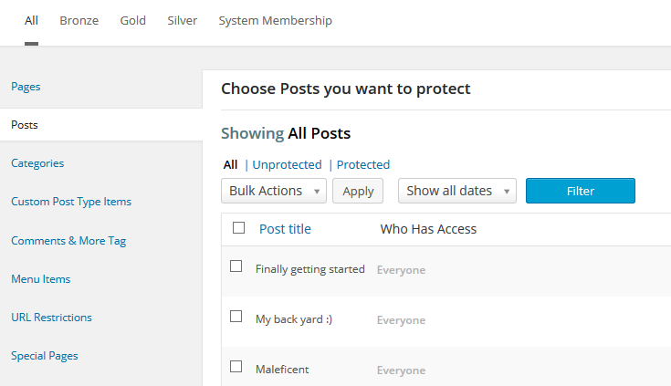

| Regeltyp | Einsatz |
|---|---|
| Seiten und Beiträge | Einzelne Inhalte oder Inhaltstypen schützen. |
| Kategorien | Ganze Kategorien mit einem Regelwerk schützen. |
| Benutzerdefinierte Beitragstypen | Eigene Inhaltstypen und Gruppen absichern. |
| Inhaltsbereiche | Nur Teile einer Seite oder eines Beitrags schützen. |
| Medien und Dateien | Downloads direkt schützen; Medien-Add-on erforderlich. |
| Menüs und Menüpositionen | Nicht verfügbare Navigation ersetzen oder ausblenden. |
| URLs | Bestimmte Pfade und Aufrufe absichern. |
| Shortcodes | Geschützte Bereiche innerhalb eigener Vorlagen. |
| Rollen und Fähigkeiten | Zugang anhand von WordPress-Rollen oder Fähigkeiten steuern. |

### Seiten und Beiträge schützen

1. Wähle den Regeltyp **Seiten** oder **Beiträge**.
2. Wähle die zu schützenden Inhalte.
3. Ordne die berechtigten Mitgliedschaften zu.
4. Speichere die Regel.
5. Teste den Aufruf als Gast, ohne Mitgliedschaft und mit Mitgliedschaft.

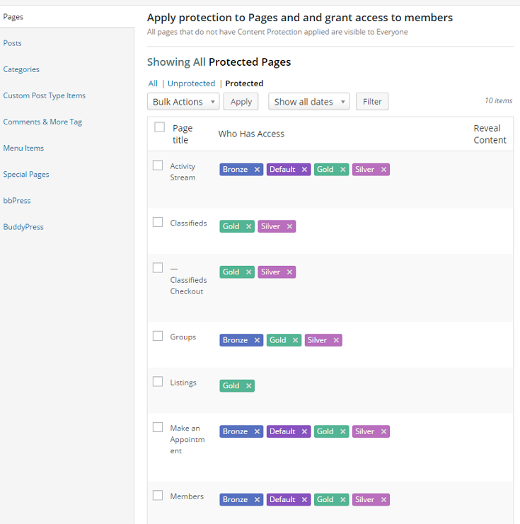

### Schutzmeldungen, Medien und Caches

Unter **Einstellungen → Schutzmeldungen** definierst Du den Text für abgelehnten Zugriff. Auf Mitgliedschaftsebene lassen sich diese Texte bei Bedarf überschreiben.

Eine geschützte Seite schützt nicht automatisch eine direkt verlinkte Datei. Aktiviere für Downloads den Medienschutz und teste die Datei-URL in einem privaten Browserfenster.

Deaktiviere bzw. konfiguriere Seiten-Caches und CDNs so, dass sie geschützte Seiten nicht als öffentliche Kopie ausliefern.

---

## Mitglieder und Abonnements verwalten

Unter **Mitgliedschaften → Alle Mitglieder** verwaltest Du Benutzer, ihre Mitgliedschaften und Abonnementstatus.

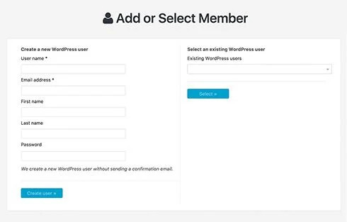

Typische Aufgaben:

- Mitglied manuell hinzufügen,
- Mitgliedschaft zuordnen oder entfernen,
- Status prüfen oder ändern,
- Bestätigung erneut versenden,
- Kontodaten und Historie einsehen.

Ändere Status nur nach einer fachlichen Prüfung. Bei externen Gateways sollen Status grundsätzlich über die Zahlungsrückmeldung entstehen.

Rechnungs- und Transaktionsdaten können personenbezogen sein. Beschränke den Zugriff im Adminbereich, definiere Aufbewahrungsfristen und exportiere Daten nur bei berechtigtem Anlass.

---

## Automatisierte E-Mails

Unter **Mitgliedschaften → Einstellungen → Automatisierte E-Mail-Antworten** werden globale E-Mail-Ereignisse verwaltet. Auf Mitgliedschaftsebene können Texte und Verhalten bei Bedarf abweichen.

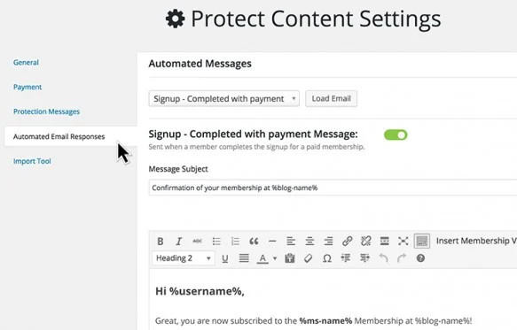

Typische Ereignisse:

- Konto erstellt und E-Mail-Bestätigung,
- Anmeldung und kostenlose Registrierung,
- Zahlung bzw. Rechnung,
- Zahlung fällig oder fehlgeschlagen,
- Testzeitraum endet,
- Mitgliedschaft wird verlängert, beendet oder gekündigt,
- Passwort zurücksetzen und Profildaten ändern.

### Gute E-Mail-Konfiguration

1. Aktiviere nur Ereignisse, die Du tatsächlich betreuen kannst.
2. Verwende Platzhalter aus dem Editor, statt Rechnungsnummern oder URLs fest einzutragen.
3. Setze eine eindeutige Absenderadresse.
4. Teste HTML- und Textdarstellung in mehreren Mailprogrammen.
5. Prüfe die E-Mail-Protokolle nach einem Testlauf.

Bei System-Cron werden Nachrichten über eine Warteschlange versendet. Ohne System-Cron kann der Versand direkt beim Ereignis erfolgen.

---

## Erweiterungen und Integrationen

Unter **Mitgliedschaften → Erweiterungen** aktivierst Du Funktionen nur bei Bedarf.

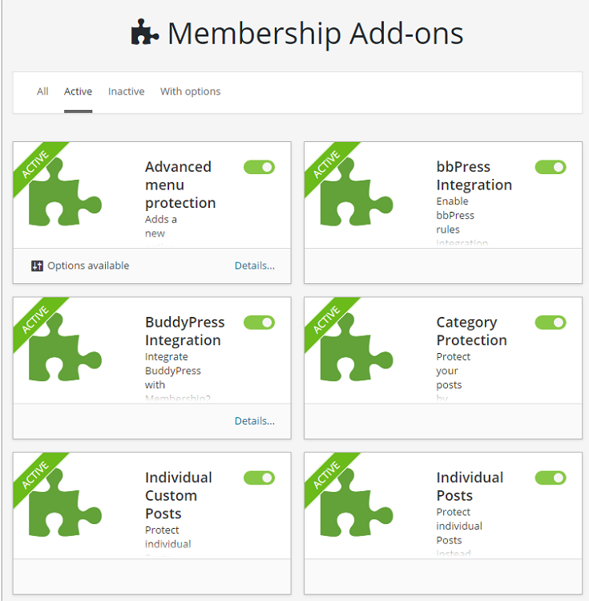

| Add-on | Zweck |
|---|---|
| Gutscheine | Rabatte oder kostenfreie Zugänge über Codes. |
| Einladungen | Registrierung nur mit Einladungscode. |
| Profilfelder | Zusätzliche Daten beim Mitglied erfassen. |
| Attribute | Eigene Mitgliedschaftsattribute für Darstellung und Regeln. |
| Anteilsberechnung | Bereits gezahlte Beträge bei Wechseln berücksichtigen. |
| Rechnungen | Erweiterte Rechnungsausgaben. |
| Kategorien / Medien | Kategorie- bzw. Dateischutz. |
| Mailchimp | Mitgliederlisten mit Mailchimp abgleichen. |
| bbPress / BuddyPress / PS Forum | Bereiche der jeweiligen Community-Integration schützen. |
| reCaptcha | Schutz für Anmeldung und Registrierung. |
| Weiterleitungen | Zielseiten nach Login oder Logout steuern. |
| WPML | Mehrsprachige Mitgliedschaftsseiten. |
| REST API | Schutz- und Mitgliedschaftsfunktionen für API-Szenarien. |

Aktiviere ein Add-on, konfiguriere es, teste es und dokumentiere die Auswirkung. Viele Regeltypen erscheinen erst nach der Aktivierung des zugehörigen Add-ons.

Externe Dienste wie Stripe, PayPal, Mailchimp oder Taxamo benötigen eigene Zugangsdaten und unterliegen deren Bedingungen. Hinterlege Zugangsdaten nie in öffentlichen Seiten, Screenshots oder Wiki-Beispielen.

---

## Nutzerleitfaden für Mitglieder

### Konto erstellen und Mitgliedschaft auswählen

1. Öffne die Registrierungsseite der Website.
2. Gib die angeforderten Daten ein und bestätige gegebenenfalls Deine E-Mail-Adresse.
3. Wähle die Mitgliedschaft, deren Zugang und Zahlungsmodell zu Dir passen.
4. Schließe die angebotene Zahlung ab.

### Per Überweisung bezahlen

1. Wähle bei der Anmeldung **Manuelle Zahlung**.
2. Notiere oder kopiere Kontoinhaber, IBAN, Betrag und Verwendungszweck.
3. Öffne Deine Banking-App.
4. Scanne den QR-Code oder übernimm die Angaben manuell.
5. Prüfe vor dem Absenden insbesondere Betrag und Verwendungszweck.

Nach dem Absenden der Überweisung bleibt die Anmeldung zunächst ausstehend. Die Freischaltung erfolgt, nachdem der Zahlungseingang geprüft wurde.

### Konto und Zugriff

Auf der Konto- bzw. Mitgliedschaftsseite kannst Du – abhängig von der Website-Konfiguration – Mitgliedschaften, Rechnungen und Profildaten einsehen oder kündigen.

Bei fehlendem Zugriff prüfe zuerst:

- Bist Du angemeldet?
- Ist die passende Mitgliedschaft aktiv?
- Ist ein Testzeitraum oder die Laufzeit abgelaufen?
- Wurde eine manuelle Überweisung bereits bestätigt?

Wenn der Zugriff weiterhin fehlt, kontaktiere den Betreiber mit Benutzername, Mitgliedschaft und – bei Zahlungsthemen – Rechnungsnummer.

---

## Checkliste für den Live-Betrieb

- [ ] Systemseiten eingerichtet und erreichbar.
- [ ] Währung, Rechnungssender und Gateways konfiguriert.
- [ ] Mindestens eine kostenlose und eine kostenpflichtige Testmitgliedschaft geprüft.
- [ ] Schutz als Gast, Benutzer ohne Mitgliedschaft und Mitglied getestet.
- [ ] Direkte Download-URLs und Cache/CDN geprüft.
- [ ] E-Mail-Absender, Platzhalter und Zustellung getestet.
- [ ] Rechnungen, Zahlungseingang und Statuswechsel geprüft.
- [ ] Single-Site- oder Multisite-Ablauf mit Testkonten abgenommen.
- [ ] Screenshots und Wiki-Beispiele enthalten keine echten Zugangsdaten oder Bankdaten.

## Pflege des Handbuchs

- Ergänze neue Funktionen direkt in diesem Handbuch.
- Aktualisiere Screenshots mit anonymisierten Testdaten.
- Teste Anleitungen vor der Veröffentlichung mit einem Testkonto.
- Technische Build- und Release-Hinweise stehen in [BUILD.md](./BUILD.md).
