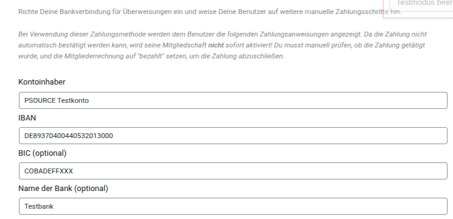

# Handbuch: Manuelle SEPA-Überweisung

Dieses Handbuch beschreibt das manuelle Überweisungs-Gateway von **PS Mitgliedschaften**. Es ist für die Übernahme in ein Wiki geeignet und trennt die Aufgaben von Administratoren und Mitgliedern.

## Überblick

Mitglieder können ihren Beitrag per Banküberweisung bezahlen. Das Gateway zeigt dazu die Bankverbindung, den exakten Betrag und einen eindeutigen Verwendungszweck an. Bei Euro-Zahlungen mit gültiger IBAN erzeugt es zusätzlich einen EPC-QR-Code für Banking-Apps.

Die Überweisung wird nicht automatisch als bezahlt erkannt:

1. Das Mitglied wählt die manuelle Zahlung aus.
2. Die Rechnung erhält den Status **ausstehend**.
3. Das Mitglied überweist den Betrag.
4. Ein Administrator gleicht den Zahlungseingang ab und markiert die Rechnung als bezahlt.
5. Erst danach wird die Mitgliedschaft aktiviert bzw. fortgeführt.

## Für Administratoren

### 1. Manuelles Gateway öffnen

1. Öffne im ClassicPress-Adminbereich **Mitgliedschaften → Einstellungen → Zahlung**.
2. Klappe unter **Zahlungsgateways** den Bereich **Manuelles Zahlungsgateway** auf.
3. Trage die Bankverbindung ein.

> Das Bild verwendet lokale Testdaten. Für die Produktivseite müssen Kontoinhaber, IBAN, BIC und Bankname durch die tatsächlichen Zahlungsdaten ersetzt werden.

### 2. Bankverbindung einrichten

| Feld | Erforderlich | Zweck |
|---|---:|---|
| **Kontoinhaber** | Ja für den QR-Code | Name des Zahlungsempfängers. |
| **IBAN** | Ja für den QR-Code | Zielkonto. Leerzeichen werden beim Speichern entfernt. |
| **BIC** | Nein | Wird verwendet, sofern sie formal gültig ist. |
| **Name der Bank** | Nein | Zusätzliche Information für Mitglieder. |
| **Verwendungszweck-Präfix** | Empfohlen | Wird vor die eindeutige Rechnungsnummer gesetzt, zum Beispiel `Mitgliedschaft #123-4`. |
| **Zahlungsinformationen** | Nein | Zusätzliche Hinweise, etwa Bearbeitungszeit oder Kontaktadresse. |
| **Etikett oder URL der Zahlungsschaltfläche** | Nein | Beschriftung der Schaltfläche im Registrierungsablauf. |

Die Einstellungen werden beim Verlassen eines Feldes gespeichert. Nach dem Neuladen sollten IBAN und BIC ohne Leerzeichen und in Großbuchstaben angezeigt werden.

### 3. EPC-QR-Code prüfen

Ein QR-Code wird nur angezeigt und per E-Mail eingebettet, wenn alle folgenden Bedingungen erfüllt sind:

- Die Rechnungswährung ist **EUR**.
- Ein Kontoinhaber ist hinterlegt.
- Die IBAN ist formal gültig, einschließlich Prüfziffer.
- Betrag und Verwendungszweck sind vorhanden.

Der QR-Code wird vollständig auf dem Server erzeugt. Bankdaten werden dabei nicht an einen externen QR-Dienst übermittelt.

### 4. Zahlungseingang bestätigen

1. Öffne **Mitgliedschaften → Abrechnung**.
2. Suche die ausstehende Rechnung anhand des Verwendungszwecks bzw. der Rechnungsnummer.
3. Vergleiche Betrag, IBAN und Verwendungszweck mit dem Kontoauszug.
4. Markiere die Rechnung erst nach vollständigem Zahlungseingang als **bezahlt**.

Das manuelle Gateway aktiviert eine kostenpflichtige Mitgliedschaft bewusst nicht bei der Auswahl der Zahlart. So können unbezahlte Anmeldungen nicht versehentlich als aktiv gelten.

### 5. E-Mail-Versand kontrollieren

Sobald ein Mitglied die manuelle Zahlung auswählt, erhält es eine HTML-E-Mail mit:

- Hinweis auf den ausstehenden Zahlungseingang,
- Kontoinhaber, Bankname, IBAN, BIC, Betrag und Verwendungszweck,
- EPC-QR-Code als eingebettetes PNG-Bild.

Der QR-Code wird in der E-Mail über eine Content-ID eingebettet. Dadurch funktioniert er auch in Mailprogrammen, die externe Bilder oder SVG-Dateien blockieren.

## Für Mitglieder

### Per Überweisung bezahlen

1. Wähle bei der Anmeldung **Manuelle Zahlung**.
2. Notiere oder kopiere Kontoinhaber, IBAN, Betrag und Verwendungszweck.
3. Öffne Deine Banking-App.
4. Scanne den QR-Code oder übernimm die Angaben manuell.
5. Prüfe vor dem Absenden insbesondere Betrag und Verwendungszweck.

Die Banking-App übernimmt aus dem QR-Code Empfänger, IBAN, optional BIC, Betrag und Verwendungszweck. Das spart Zeit und reduziert Tippfehler.

### Was passiert nach der Überweisung?

Nach dem Absenden der Überweisung bleibt die Anmeldung zunächst ausstehend. Die Freischaltung erfolgt, nachdem der Zahlungseingang geprüft wurde. Die Bearbeitungszeit richtet sich nach dem jeweiligen Anbieter.

## Fehlerbehebung

### Kein QR-Code sichtbar

Prüfe als Administrator:

1. Ist die Währung der Rechnung EUR?
2. Sind Kontoinhaber und eine gültige IBAN eingetragen?
3. Sind Betrag und Verwendungszweck der Rechnung vorhanden?
4. Wurde die Seite nach dem Speichern der Einstellungen neu geladen?

Mitglieder können die Überweisung auch ohne QR-Code anhand der angezeigten Bankdaten ausführen.

### QR-Code fehlt in der E-Mail

Prüfe, ob die E-Mail als HTML-Nachricht zugestellt wird und ob der Server eingebettete Bilder zulässt. Die Überweisungsdaten selbst bleiben immer Teil der Nachricht, sodass eine Zahlung auch ohne Bild möglich ist.

### Zahlung bleibt ausstehend

Das ist bis zur manuellen Prüfung normal. Suche die Rechnung in der Abrechnung über die Rechnungsnummer im Verwendungszweck und bestätige sie nach Zahlungseingang.

## Checkliste vor dem Live-Betrieb

- [ ] Kontoinhaber und IBAN stammen vom richtigen Empfängerkonto.
- [ ] Der Verwendungszweck-Präfix ist verständlich.
- [ ] Die Währung für kostenpflichtige Mitgliedschaften ist EUR.
- [ ] Eine Testanmeldung erzeugt den Status **ausstehend**.
- [ ] Der QR-Code wird in einer Banking-App korrekt gelesen.
- [ ] Die E-Mail enthält Bankdaten und QR-Code.
- [ ] Nach dem manuellen Markieren als bezahlt wird die Mitgliedschaft wie erwartet aktiviert.
