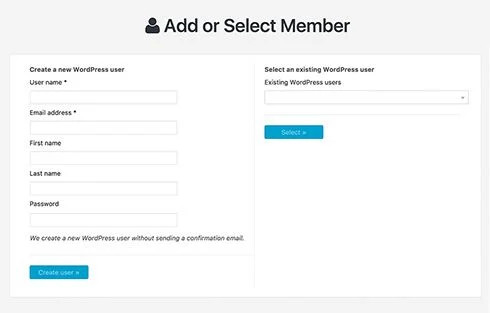

# Mitglieder, Abonnements und Abrechnung

[← Zur Übersicht](./index.md)

## Mitgliederverwaltung

Unter **Mitgliedschaften → Alle Mitglieder** verwaltest Du Benutzer, ihre Mitgliedschaften und Abonnementstatus.

Typische Aufgaben:

- Mitglied manuell hinzufügen,
- Mitgliedschaft zuordnen oder entfernen,
- Status prüfen oder ändern,
- Bestätigung erneut versenden,
- Kontodaten und Historie einsehen.

## Wichtige Status

| Status | Bedeutung |
|---|---|
| **Neu** | Rechnung bzw. Anmeldung wurde angelegt, aber noch nicht abgeschlossen. |
| **Ausstehend / billed** | Zahlung wurde angefordert oder manuell ausgewählt, aber noch nicht bestätigt. |
| **Aktiv** | Mitgliedschaft ist gültig und gewährt Zugang. |
| **Testphase** | Zugang ist bis zum Ende des Testzeitraums aktiv. |
| **Abgelaufen / beendet** | Laufzeit ist beendet; Zugang richtet sich nach der Konfiguration. |
| **Gekündigt** | Keine weitere Verlängerung; vorhandener Zugang kann bis zum Ablauf bestehen bleiben. |

Ändere Status nur nach einer fachlichen Prüfung. Bei externen Gateways sollen Status grundsätzlich über die Zahlungsrückmeldung entstehen.

## Abrechnung und Rechnungen

Unter **Mitgliedschaften → Abrechnung** findest Du Rechnungen, Transaktionen und Protokolle.

Nutze die Abrechnung für:

- Zahlungsstatus prüfen,
- Rechnung öffnen und Betrag kontrollieren,
- Transaktion einem Mitglied zuordnen,
- bei manuellen Zahlungen den Eingang bestätigen,
- Gateway- und Kommunikationsprotokolle prüfen.

### Manuelle Zahlung bestätigen

1. Suche die Rechnung anhand der Rechnungsnummer oder des Verwendungszwecks.
2. Vergleiche Betrag und Zahlungseingang.
3. Markiere die Rechnung als bezahlt.
4. Prüfe anschließend Mitgliedsstatus und Zugang.

## Wiederkehrende Mitgliedschaften

Bei wiederkehrenden Zahlungen sind zusätzlich Fälligkeit, fehlgeschlagene Zahlung, Erneuerung, Kündigung und Kartenablauf relevant. Richte hierfür E-Mail-Ereignisse ein und teste mindestens eine erfolgreiche sowie eine fehlgeschlagene Verlängerung im Sandbox-Modus.

## Datenschutz und Protokolle

Rechnungs- und Transaktionsdaten können personenbezogen sein. Beschränke den Zugriff im Adminbereich, definiere Aufbewahrungsfristen und exportiere Daten nur bei berechtigtem Anlass.

