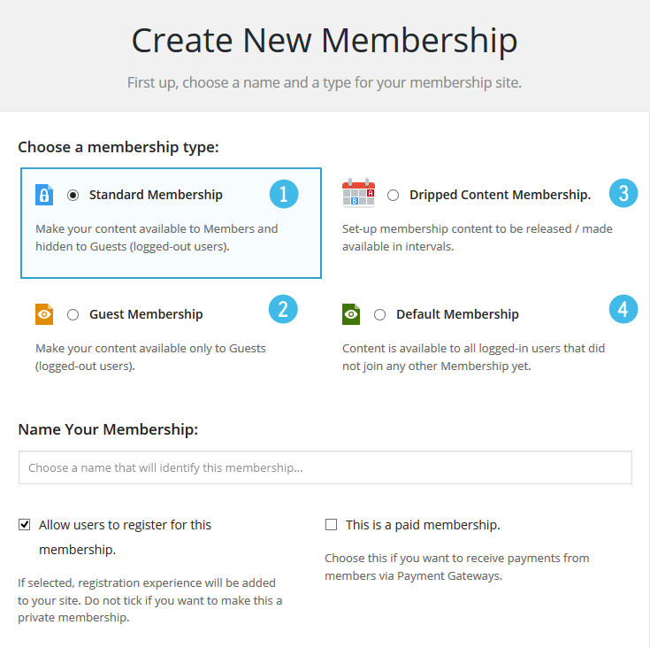
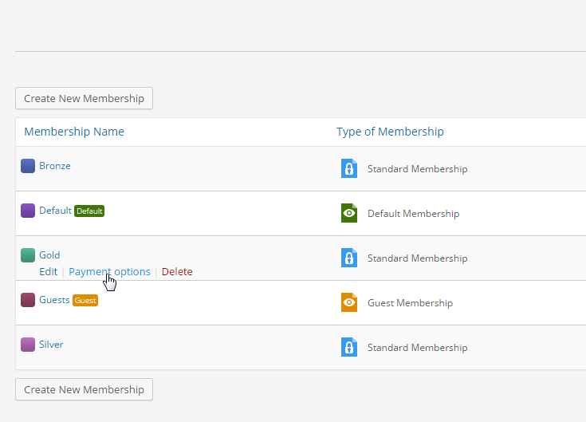
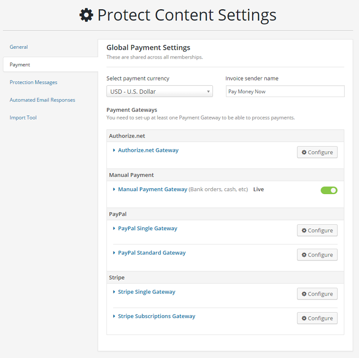

# Mitgliedschaften und Zahlungen

[← Zur Übersicht](./index.md)

## Mitgliedschaft anlegen

Öffne **Mitgliedschaften → Mitgliedschaften → Neu hinzufügen**. Vergib einen eindeutigen Namen, eine verständliche Beschreibung und lege danach Typ, Zugang und Zahlung fest.

## Mitgliedschaftstypen

| Typ | Geeignet für |
|---|---|
| **Standardmitgliedschaft** | Dauerhafte oder befristete Zugänge zu geschützten Inhalten. |
| **Intervall-Mitgliedschaft** | Zeitversetzte Freischaltung, etwa Lektionen oder Kursmodule. |
| **Gastmitgliedschaft** | Inhalte ausschließlich für nicht angemeldete Besucher. |
| **Keine-Mitgliedschaft** | Inhalte für angemeldete Benutzer ohne sonstige Mitgliedschaft. |

Je nach Typ heißt der Zahlungsbereich **Zahlungsoptionen** oder **Zugriffsoptionen**. Bei Gast- und Keine-Mitgliedschaft sind nicht alle Zahlungsoptionen sinnvoll oder verfügbar.

## Zahlungs- und Zugriffsoptionen

Lege pro Mitgliedschaft fest:

- kostenlos oder kostenpflichtig,
- Preis und Währung,
- einmalige oder wiederkehrende Zahlung,
- Laufzeit und Ablaufverhalten,
- optionalen Testzeitraum,
- zulässige Upgrades und Downgrades,
- passende Systemseiten, Schutzmeldungen und E-Mails.

## Zahlungs-Gateways

Die globale Gateway-Konfiguration befindet sich unter **Mitgliedschaften → Einstellungen → Zahlung**.

| Gateway | Typischer Einsatz | Hinweis |
|---|---|---|
| **Kostenlos** | Kostenlose Mitgliedschaften | Kein externer Zahlungsdienst nötig. |
| **Manuelle Zahlung** | Überweisung, Barzahlung oder individuelle Rechnung | Zahlung muss durch einen Administrator bestätigt werden. |
| **Stripe** | Karten- und weitere Stripe-Zahlmethoden | Zugangsdaten und Webhooks prüfen. |
| **PayPal Standard / Single** | PayPal-Zahlungen | Sandbox zunächst für Tests verwenden. |
| **Authorize.net** | Authorize.net-Integration | API-Zugangsdaten erforderlich. |

### Testen von Zahlungen

1. Verwende Testmodus bzw. Sandbox des externen Gateways.
2. Lege eine Test-Mitgliedschaft mit geringem Betrag an.
3. Führe Kauf, Rückkehr zur Website und Kontoansicht durch.
4. Prüfe Rechnung, Transaktionsprotokoll und Mitgliedsstatus.
5. Teste fehlgeschlagene, abgebrochene und wiederkehrende Zahlungen separat.

### Manuelle SEPA-Überweisung

Die ausführliche Einrichtung einschließlich IBAN, BIC, QR-Code, E-Mail und manueller Freigabe steht im [Handbuch zur manuellen SEPA-Überweisung](./manual-bank-transfer.md).

## Upgrades und Downgrades

Lege erlaubte Wechsel nur dann an, wenn Preis, Restlaufzeit und Zielzugang fachlich klar definiert sind. Mit dem Add-on **Anteilsberechnung** können bereits gezahlte Beträge beim Wechsel berücksichtigt werden.

Prüfe Wechsel immer mit Testkonten: Zugang zum alten Inhalt, Zugang zum neuen Inhalt, Rechnung und Folgetermin.

