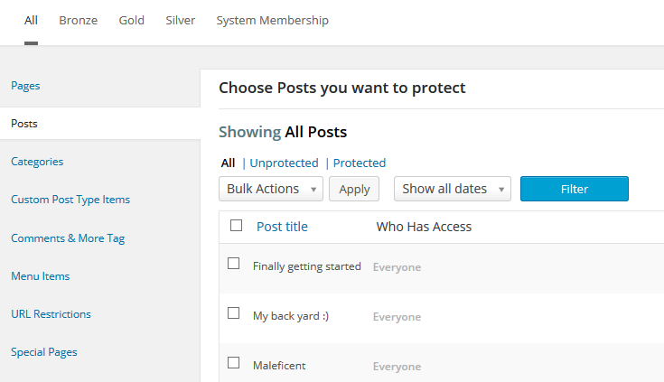
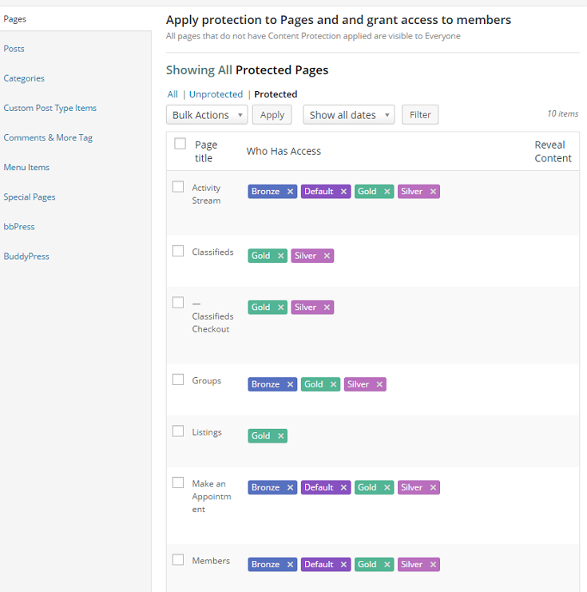

# Inhalte schützen

[← Zur Übersicht](./index.md)

## Schutzprinzip

Eine Mitgliedschaft allein schützt noch keinen Inhalt. Erst eine Schutzregel legt fest, welche Mitgliedschaft auf welchen Inhalt zugreifen darf.

Öffne **Mitgliedschaften → Schutzregeln** und wähle den passenden Regeltyp.

## Regeltypen

| Regeltyp | Einsatz |
|---|---|
| Seiten und Beiträge | Einzelne Inhalte oder Inhaltstypen schützen. |
| Kategorien | Ganze Kategorien mit einem Regelwerk schützen. |
| Benutzerdefinierte Beitragstypen | Eigene Inhaltstypen und Gruppen absichern. |
| Inhaltsbereiche | Nur Teile einer Seite oder eines Beitrags schützen. |
| Medien und Dateien | Downloads direkt schützen; Medien-Add-on erforderlich. |
| Menüs und Menüpositionen | Nicht verfügbare Navigation ersetzen oder ausblenden. |
| URLs | Bestimmte Pfade und Aufrufe absichern. |
| Shortcodes | Geschützte Bereiche innerhalb eigener Vorlagen. |
| Rollen und Fähigkeiten | Zugang anhand von WordPress-Rollen oder Fähigkeiten steuern. |

Die verfügbaren Regeln hängen von aktivierten Add-ons ab.

## Seiten und Beiträge schützen

1. Wähle den Regeltyp **Seiten** oder **Beiträge**.
2. Wähle die zu schützenden Inhalte.
3. Ordne die berechtigten Mitgliedschaften zu.
4. Speichere die Regel.
5. Teste den Aufruf als Gast, ohne Mitgliedschaft und mit Mitgliedschaft.

## Schutzmeldungen

Unter **Einstellungen → Schutzmeldungen** definierst Du den Text für abgelehnten Zugriff. Auf Mitgliedschaftsebene lassen sich diese Texte bei Bedarf überschreiben.

Eine gute Schutzmeldung enthält:

- eine kurze Erklärung, warum der Inhalt nicht verfügbar ist,
- einen Link zur Anmeldung oder Mitgliedschaftsauswahl,
- gegebenenfalls den Hinweis auf die benötigte Mitgliedschaft.

## Medien, Caches und direkte URLs

Eine geschützte Seite schützt nicht automatisch eine direkt verlinkte Datei. Aktiviere für Downloads den Medienschutz und teste die Datei-URL in einem privaten Browserfenster.

Deaktiviere bzw. konfiguriere Seiten-Caches und CDNs so, dass sie geschützte Seiten nicht als öffentliche Kopie ausliefern.

## Redaktions-Checkliste

- [ ] Regel einer echten Mitgliedschaft zugeordnet.
- [ ] Gast sieht Schutzmeldung statt Inhalt.
- [ ] Mitglied ohne passende Mitgliedschaft erhält keinen Zugriff.
- [ ] Berechtigtes Mitglied sieht den vollständigen Inhalt.
- [ ] Direkte Download-URL getestet.
- [ ] Menülink zeigt keine unberechtigten Ziele.

