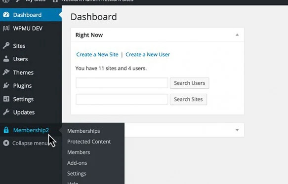

# Single Site und Multisite

[← Zur Übersicht](./index.md)

## Single-Site-Betrieb

Im Single-Site-Betrieb gelten Einstellungen, Mitgliedschaften, Schutzregeln und Systemseiten für genau diese Website.

Empfehlung:

1. Richte die Seiten ein.
2. Lege Mitgliedschaften und Regeln an.
3. Teste die Rollen Gast, angemeldeter Benutzer und Mitglied.
4. Aktiviere erst dann zusätzliche Gateways und Add-ons.

## Multisite-Betrieb

In einer Multisite-Installation kann PS Mitgliedschaften netzwerkweit betrieben werden. Die netzwerkweite Schutzfunktion ermöglicht eine zentrale Verwaltung, berücksichtigt jedoch weiterhin die jeweilige Website bzw. Blog-ID in Regeln und Daten.

### Vor der Aktivierung im Netzwerk

- Entscheide, ob Mitgliedschaften zentral oder je Website verwaltet werden sollen.
- Prüfe, ob das Plugin im Netzwerk oder nur auf einzelnen Websites aktiviert wird.
- Vermeide parallele bzw. widersprüchliche Aktivierungen.
- Definiere, welche Administratoren Regeln und Zahlungen verwalten dürfen.
- Prüfe alle betroffenen Websites auf eigene Caches, Menüs und Systemseiten.

### Betriebshinweise

| Thema | Empfehlung |
|---|---|
| Schutzregeln | Regel immer auf der betroffenen Website testen. |
| Systemseiten | Für jede Website korrekte Registrierung, Konto- und Auswahlseiten prüfen. |
| Zahlungen | Eindeutige Rechnungs- und Verwendungszwecke verwenden. |
| Benutzer | Prüfen, wie Benutzerkonten und Rollen netzwerkweit geteilt werden. |
| Caching | Website- und CDN-Caches für geschützte Inhalte getrennt prüfen. |
| Änderungen | Nach Wechsel der netzwerkweiten Schutzart vollständige Regressionstests ausführen. |

## Multisite-Abnahmetest

1. Erstelle oder wähle zwei Websites im Netzwerk.
2. Schütze auf beiden jeweils einen Inhalt.
3. Teste Zugang mit derselben Mitgliedschaft und unterschiedlichen Benutzerkonten.
4. Prüfe Menü, direkte URL, Medien und Kontoansicht je Website.
5. Wiederhole den Test nach Cache-Leerung.

## Umzug zwischen Single Site und Multisite

Ein Wechsel ist kein reines Umschalten. Sichere Datenbank und Einstellungen, dokumentiere Systemseiten und Regeln und teste den neuen Betrieb zunächst in einer Staging-Umgebung.

